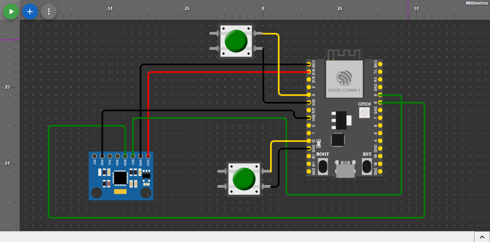

# ESP32-C3 Air Mouse

An air mouse project using an ESP32-C3, MPU6050 motion sensor, and two push buttons. The goal is to control a computer cursor using hand movement and perform left and right clicks.

## Features

- Motion sensing using MPU6050
- Left and right mouse click buttons
- Bluetooth Low Energy (BLE) mouse implementation
- Wokwi circuit simulation for testing the sensor and buttons

## Components

- ESP32-C3
- MPU6050 sensor
- 2 push buttons
- Connecting wires

## Circuit connections

| Component | ESP32-C3 |
|---|---|
| MPU6050 VCC | 3.3V |
| MPU6050 GND | GND |
| MPU6050 SDA | GPIO 8 |
| MPU6050 SCL | GPIO 9 |
| MPU6050 AD0 | GND |
| Left button | GPIO 3 and GND |
| Right button | GPIO 10 and GND |

## Project screenshots

### Wokwi circuit

### Serial Monitor output

## How to run

1. Open the circuit in Wokwi and start the simulation.
2. Check the Serial Monitor to verify sensor readings and button states.
3. For the Bluetooth mouse implementation, upload the Arduino sketch to a physical ESP32-C3 using the required libraries.

Note: Wokwi simulation is used to test the sensor and buttons. Bluetooth mouse pairing requires physical hardware.

## Project files

- `sketch.ino` – Arduino program
- `diagram.json` – Wokwi circuit
- `images/` – Project screenshots
